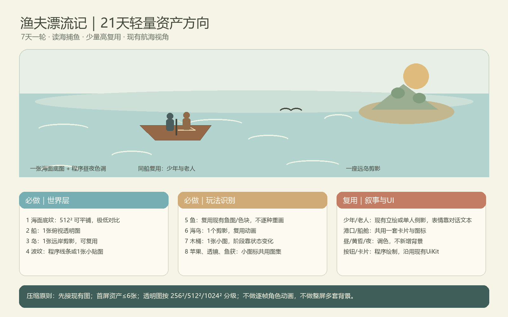

# 21天项目轻量美术资产方向（圈1优先）

日期：2026-10-11  
用途：替换“水彩海岛冒险资产集”的生产方向；作为资产取舍和交付规格，不代表所有素材已制作或已接入。

## 一、按项目定位收敛

《渔夫漂流记》的核心是少年与老人共同出海、捕鱼、观察海面信号，并在7天循环中通过知识行动改变结局。视觉必须优先服务海面可读性和行动反馈。圈1需要完整7天闭环；鲸鱼、美人鱼、夜间生物、灯塔探索、复杂遗迹和多事件演出均可后置。

原参考资产集包含多座岛和港镇、多种建筑、角色多角度、丰富生物、成套海面和四时段卡片，属于较完整的冒险游戏素材库。对21天制作周期来说，资产数量、风格统一、拆件接入和持续维护成本偏高；其俯视岛镇表达也不贴合当前航海画面。

**新方向：轻绘本航海 + 极简剪影 + 少量暖色手绘细节。** 保留现有青蓝海面、暖赭描边与淡纸感；降低水彩纹理对比，让鱼群、海鸟、水花等功能信号清楚可辨。背景使用当前世界投影视角，不改成俯视岛屿地图。

## 二、最小生产清单

| 优先级 | 资产 | 最小交付 | 复用方式 / 说明 |
|---|---|---|---|
| P0 | 海面底纹 | 1张无缝底纹，256²或512² | 平铺；昼夜以程序色调变化，不制作多张海面 |
| P0 | 玩家渔船 | 1张透明俯视图 | 复用移动、朝向和漂浮；不画多个船型/船舱角度 |
| P0 | 远岸小岛 | 1张透明剪影 | 复用于远景地标；近景岛屿用已有程序色块/几何 |
| P0 | 鱼群 | 优先复用当前鱼资源；必要时补1张通用小鱼剪影 | 鱼种差异由色相/尺寸或现有图鉴图标承担，避免逐种重画 |
| P0 | 读海信号 | 海鸟1种、水花/波纹1套 | 海鸟用翻转/缩放复用；波纹用程序线条或现有小贴图 |
| P0 | 木桶与透镜路线 | 木桶1张；透镜1个小图标 | 三阶段检查依靠文案、轮廓/高亮状态，不做三个桶模型 |
| P0 | 苹果、鱼获、资源图标 | 1个小型图集 | 优先使用现有WatercolorUI图标；图标与按钮统一尺寸、描边 |
| P0 | 少年与老人 | 优先复用现有角色立绘；若航海画面确需角色，只补一组简化侧影 | 对话情绪靠文本和少量头像状态，不制作完整逐帧动画 |
| P1 | 港口/船舱 | 不新增独立场景插画 | 复用当前港口底图、通用卡片和现有UI组件 |
| P2 | 遗迹、灯塔、鲸鱼等 | 本周期不列入必做 | 只有在圈1闭环和验收完成后再选一项扩展 |

## 三、制作与内存规格

- 先接入并压缩现有可用图，新增图片控制在约6张以内；优先替换而非叠加多个同用途版本。
- 纹理边长统一按用途分档：小图标256²以内，普通对象512²以内，只有主船或必须的场景图才使用1024²；避免把角色图和小物件交付成超大画布。
- PNG仅用于需要透明的对象；不透明平铺底纹使用适合平台的压缩格式/导入压缩，避免为纸纹保存高频噪点。具体格式以Maker导入和最终构建支持为准。
- 合并同类小图标为一个图集；界面按钮和面板优先程序绘制并沿用现有UiKit，不再为每种状态生成单独大图。
- 首屏只预载闭环必需资源；图鉴扩展图标和候选内容按需加载。避免同时常驻原图、Story变体和第二套风格包。
- 角色不做逐帧全身动画；船、鸟用现有旋转/缩放/位置动画，水面动效复用程序笔触与波纹。
- 四时段由同一组世界素材调色和少量光色叠加完成，不复制四份背景。

## 四、现有工程可直接复用

- 主航海已使用 `assets/image/OceanLoop/` 下6张运行资源：船、岛、海鸟、木桶、波纹和底纹。建议以这套作为唯一主场景版本，继续优化色彩和文件规格，不再并存两套大尺寸替代图。
- `assets/image/WatercolorUI/` 已有资源图标、海洋生物、面板和角色素材；圈1优先核验实际引用后复用，不按目录数量推断必须接入。
- `scripts/Gameplay/UiKit.lua` 已承担卡片/按钮样式令牌，新增UI沿用令牌与程序绘制。
- OceanLoop当前目录六图约3.36MiB PNG文件体积；该数字是压缩文件大小，不等于运行时显存占用。RGBA纹理未压缩时按宽×高×4估算：六图约7.5MiB，另加mipmap等开销。应在实际目标设备/最终构建确认峰值，不以PNG体积单独代表内存。
- 已有OceanStory大图目前作为候选变体、默认关闭。不要因为已生成就把整套也预载；如需替换，先确认运行效果和授权/来源记录，再删除或归档旧版本。

## 五、圈1完成判断

只要玩家能清楚分辨船、鱼群、海鸟/水花信号、木桶与关键物品，并读懂白天/黄昏/夜晚风险，完成捕鱼、港口、老人互动、日结及结局重开，便不需要继续增加装饰资产。每张新增图必须对应明确玩法识别或反馈点；没有独立用途的建筑、摆件和角色姿势不进入21天必做集。

## 六、与项目文档的关系

本方向依据《01_游戏总览》《02_三圈范围》《06_视听与交互》及Ocean主航海素材报告整理。原附件只作为参考，不将其中绘制内容视作游戏设定或制作指令。本文是美术范围建议，不改玩法规则、投影、世界坐标、当前运行资源或资产来源声明。
